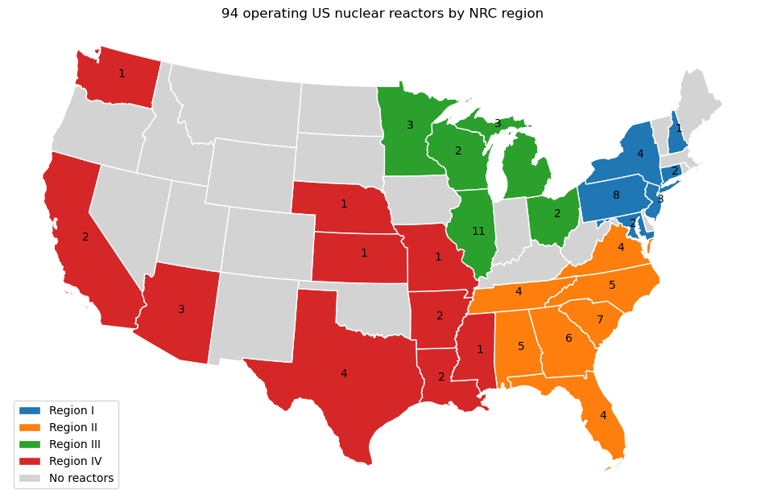
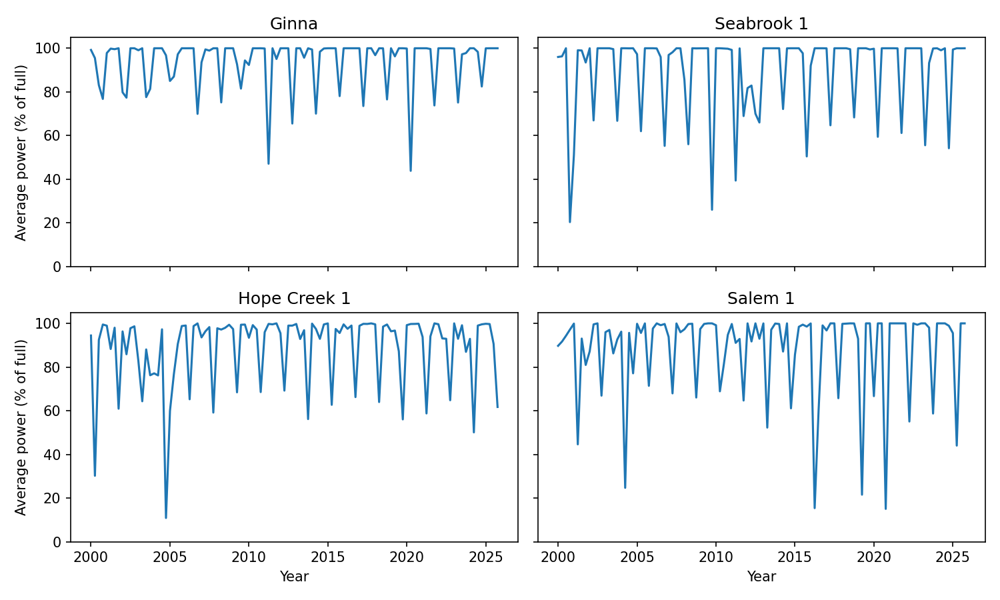

# fall-2026-nuclear-power-for-data-centers
Team project: fall-2026-nuclear-power-for-data-centers

Data centers need large amounts of power around the clock, and nuclear reactors are one of the few sources that can supply it steadily. Reactors still go offline, though, for scheduled refueling, maintenance and unexpected faults. When they do, the missing output has to come from somewhere else.

This project uses 25+ years of US Nuclear Regulatory Commission (NRC) data to measure how reliably each US reactor delivers power and to forecast its output.

## The fleet

We study the **94 currently operating US commercial reactors**, grouped into the NRC's four regions.

## Data

All data comes from the US Nuclear Regulatory Commission (NRC):

| Source | What it provides |
|---|---|
| [NRC reactor facility finder](https://www.nrc.gov/facilities-safety/facility-finder/reactors) | Name, NRC region and state of each operating reactor |
| [NRC power reactor status reports](https://www.nrc.gov/documents-reports/document-collections/events-reports-associated-with/power-reactor-status-reports/) | Daily power output of each reactor (as a % of full power) from 2000 to 2025, with the reason for any day below 100% |

We clean this data in `notebooks/DataCleaningAndPreProcessing.ipynb`. That step groups each run of consecutive days below full power into one **outage** and labels it as **refueling**, **planned maintenance** or **unplanned**.

**Finding:** Unplanned outages happen most often (44% of all outages), but they tend to be short. Refueling outages are fewer and much longer: they account for about **81% of zero-power days**, while unplanned outages account for only about 13%.

## What the data looks like

Most reactors run close to 100% most of the time, with sharp drops roughly every 18 or 24 months for refueling. There is no long-term trend; the dominant pattern is each reactor's **refueling cycle**.

That pattern is regular, but it is not exactly periodic, which is what makes forecasting hard:

- **Cycle lengths drift.** Refueling dates move from cycle to cycle, so an outage expected in one quarter can fall in the next.
- **Outage lengths vary.** Some refuelings take a few weeks; others run much longer when maintenance or repairs are added.
- **Unplanned outages are random.** They are the most common type of outage and come with no warning in the reactor's history.

