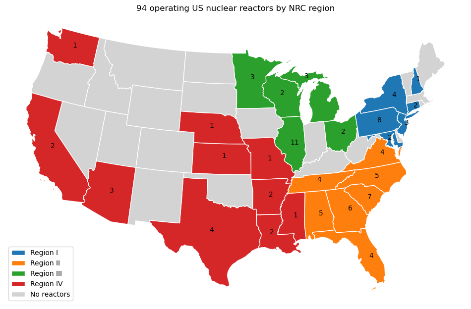
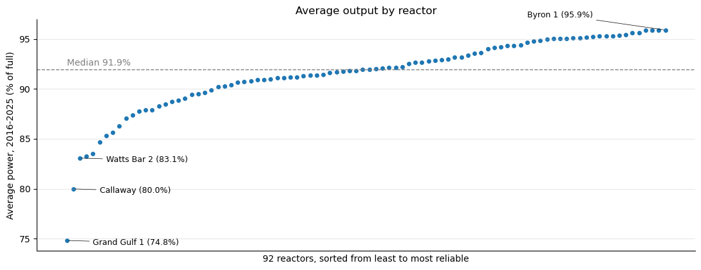
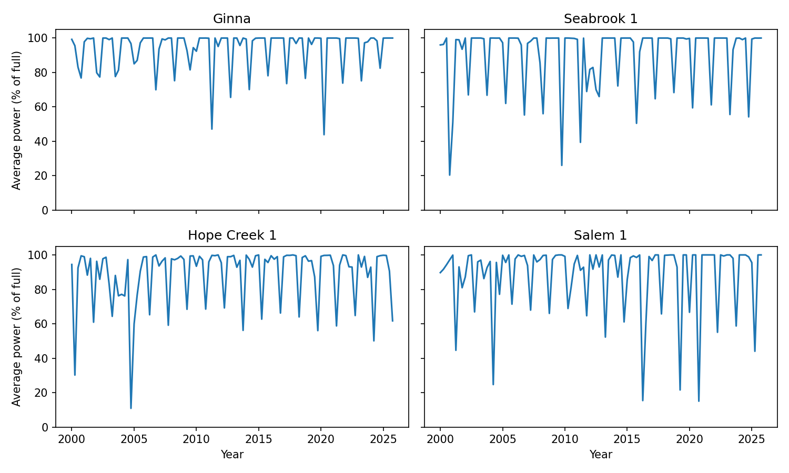
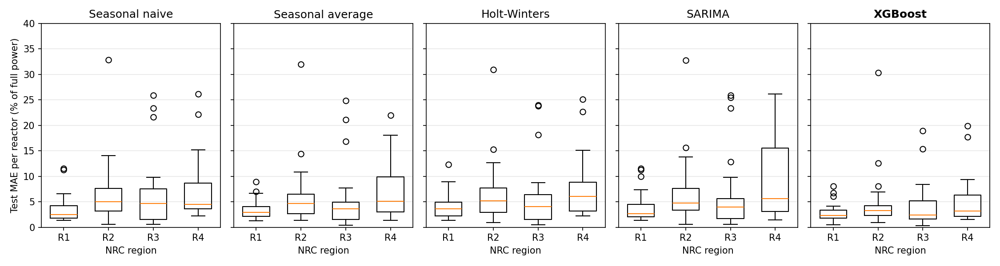

# Nuclear Reliability: Forecasting Reactor Output for Data Centers

Data centers need large amounts of power around the clock, and unlike gas, nuclear can supply it steadily without carbon emissions. Reactors still go offline, though, for scheduled refueling, maintenance and unexpected faults. When they do, the missing output has to come from somewhere else.

This project uses 25+ years of US Nuclear Regulatory Commission (NRC) data to measure how reliably each US reactor delivers power and to forecast its output.

   📄 [Read the full report](reports/Nuclear_Reliability_Project_Report.pdf) · 📊 [View the slides](reports/NuclearReliability.pdf) 
   
**[Try the interactive Reactor Explorer](https://htmlpreview.github.io/?https://github.com/Erdos-Projects/fall-2026-nuclear-power-for-data-centers/blob/main/reports/reactor_explorer.html)**: Pick a reactor or click on a state to compare our forecasts with its actual power over the 2023–2025 test period, see what caused its low quarters, and explore its zero-power days by year.

We study the **94 currently operating US commercial reactors**, grouped into the NRC's four regions.

## Why this matters

Over 2016–2025, the average power output ranged from 74.8% to 95.9% of full power. Using only public data, this project gives a data center buyer a consistent forecast of each reactor's output for the next quarter. The [report](reports/Nuclear_Reliability_Project_Report.pdf) includes a worked dollar example for Watts Bar 2.

## Data

All data comes from the US Nuclear Regulatory Commission (NRC):

| Source | What it provides |
|---|---|
| [NRC reactor facility finder](https://www.nrc.gov/facilities-safety/facility-finder/reactors) | Name, NRC region and state of each operating reactor |
| [NRC power reactor status reports](https://www.nrc.gov/documents-reports/document-collections/events-reports-associated-with/power-reactor-status-reports/) | Daily power output of each reactor (as a % of full power) from 2000 to 2025, with the reason for any day below 100% |

We clean this data in `notebooks/DataCleaningAndPreProcessing.ipynb`. That step groups each run of consecutive zero power days into one **outage** and labels it as **refueling**, **planned maintenance** or **unplanned**.

**Finding:** Unplanned outages happen most often (44% of all outages), but they tend to be short. Refueling outages are fewer and much longer: they account for about **80% of zero-power days**, while unplanned outages account for only about 14%.

## What the data looks like

Most reactors run close to 100% most of the time, with sharp drops roughly every 18 or 24 months for refueling. There is no long-term trend; the dominant pattern is each reactor's **refueling cycle**.

That pattern is regular, but it is not exactly periodic, which is what makes forecasting hard:

- **Cycle lengths drift.** Refueling dates move from cycle to cycle, so an outage expected in one quarter can fall in the next.
- **Outage lengths vary.** Some refuelings take a few weeks; others run much longer when maintenance or repairs are added.
- **Unplanned outages are random.** They are the most common type of outage and come with no warning in the reactor's history.

## Models

We train on **2000–2022** and test on **2023–2025** (12 quarters, 92 reactors). Vogtle 3 and 4 are left out because they started operating too recently, and Watts Bar 2's commissioning period (before October 2016) is removed.

All models forecast **one quarter ahead, walk-forward**: each test quarter is forecast using only data up to the end of the previous quarter.

Each model's settings are chosen on the training period only, but in a different way:

| Model | What is tuned | How |
|---|---|---|
| Seasonal naive | Nothing | — |
| Seasonal average | Number of past cycles averaged, *k* (one value for all reactors) | Walk-forward one-quarter forecasts over 2009–2019 for *k* = 2–5; *k* = 3 has the lowest Mean Absolute Error (MAE) |
| Holt-Winters | $\alpha$ and $\gamma$, per reactor | Grid search over 0.1–0.9. At six cutoffs from 2009 to 2020, fit on the last 4 cycles before the cutoff and score the forecast of the next full cycle |
| SARIMA | Model orders, per reactor | `auto_arima` (lowest AIC) on the last 4 cycles before 2023 |
| XGBoost | `max_depth`, `learning_rate`; `n_estimators` by early stopping | Expanding window: at cutoffs 2015, 2017, 2019 and 2021, train on all quarters before the cutoff and validate on the quarters from the cutoff to the end of 2022 |

## Results

Each model's MAE is computed per reactor over the 12 test quarters (2023–2025). The table summarizes those per-reactor errors across the 92 reactors, in percentage points of full power (lower is better):

| Model | Mean | 25th pct | Median | 75th pct | 90th pct | Max |
|---|---|---|---|---|---|---|
| Seasonal naive | 6.15 | 2.53 | 4.33 | 6.97 | 11.55 | 32.87 |
| Seasonal average (*k* = 3) | 5.59 | 2.40 | 3.94 | 6.18 | 11.10 | 31.97 |
| Holt-Winters | 6.22 | 2.84 | 4.64 | 7.02 | 12.67 | 30.97 |
| SARIMA | 6.62 | 2.55 | 3.99 | 7.61 | 15.47 | 32.79 |
| **XGBoost** | **4.31** | **2.03** | **2.96** | **4.51** | **8.02** | **30.33** |

- **Among the univariate models, the seasonal average does best.** It has the lowest mean and the lowest error at every percentile.
- **XGBoost is the best model overall.** All models forecast one quarter ahead over the same test quarters, so the comparison is direct. XGBoost cuts the mean error from 5.59 (seasonal average) to 4.31, about 23%, and the median from 3.94 to 2.96.
- **Errors are concentrated in a few reactors.** For every model the mean is well above the median, and the worst reactors have errors around 30. XGBoost's largest errors are for Sequoyah 2 (Region 2, 30.3), Waterford 3 (Region 4, 19.9) and Prairie Island 1 (Region 3, 19.0). No model anticipates refueling outages that run much longer than usual, changes in cycle length, or unplanned outages.
- **The gain varies by reactor.** XGBoost beat seasonal average on 70 of 92 reactors, with the largest gains on reactors where seasonal average struggled. The 23% improvement has a 95% bootstrap interval of 15% to 31%, resampling reactors.
- **Test discipline.** All model settings were chosen using data through 2022, before evaluating the 2023–2025 test period.

## Repo Structure

| Folder | What it Contains |
|---|---|
| `data/raw/nrc/` | Raw NRC data: daily reports by year in `daily_reports/` and yearly power status files in `yearly_reports/`.|
| `data/processed/nrc/` | Cleaned data: the reactor list, yearly cleaned files and outages in `cleaned_data/`|
| `data/processed/` | Seasonal average scores, which `AdvancedForecasts` uses to measure XGBoost's improvement. |
| `notebooks/` | Notebook versions of the code in `src/`|
| `src/` | Python code for the map, data cleaning and forecasting models. |
| `reports/` | The project report, the slides, and the figures used in this README. |

| Code | What it Does |
|---|---|
| `src/ReactorMap.py` | Generates a map of operating nuclear reactors across the United States. |
| `src/DataCleaningAndPreProcessing.py` | Downloads NRC daily reports, then cleans them, groups zero-power days into outages and labels each outage by type. |
| `src/PreliminaryForecasts.py` | Performs forecasting using four models: Seasonal Naive, Seasonal Average, Holt-Winters, and SARIMA. |
| `src/AdvancedForecasts.py` | Performs forecasting using XGBoost. |
| `src/WheretheGainComes.py` | Shows where XGBoost's improvement comes from: false alarms and low-power quarters. |

## Reproduce the results

pip install -r requirements.txt

Run the notebooks in this order: `DataCleaningAndPreProcessing`, `PreliminaryForecasts`, `AdvancedForecasts`.
